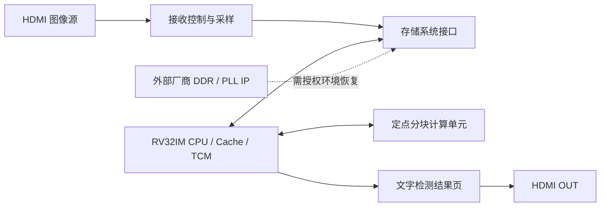

# ARGONAUTICA · 紫光RISCV指令集CPU设计

面向盘古 50K FPGA 的五级 RV32IM 处理器与嵌入式计算系统。

自研 CPU 运行裸机程序，通过内存映射接口调度定点运算单元。完整系统可从板载 Flash 自启动，循环完成 HDMI 图像采样、YOLO 目标检测与文字结果显示。

仓库提供项目源码、模型数据、工程参考与验证摘要。完整板级构建需要在具备相应授权的 PDS 环境中恢复厂商 IP，并重新生成配置镜像。恢复步骤见 [IP 恢复说明](IP_RESTORE.md)。

## 系统设计



- CPU 采用取指、译码、执行、访存和写回五级流水，支持乘除法、数据前递、停顿、32 项分支目标缓冲及机器态异常中断。
- 指令缓存和数据缓存均为两路组相联。识别应用的热点代码和栈使用片上 TCM，模型与工作区主要使用 DDR3。
- CPU 调度 INT8 点积与定点量化，并运行 YOLO-Fastest 1.1 COCO 模型的后处理。
- HDMI 输入为 1920×1080、60 Hz，模型帧为 320×320，HDMI 输出为 640×480 文字结果页。

## 源码目录

| 路径 | 内容 |
|---|---|
| `rtl/`、`constr/` | CPU、Cache、SoC、外设与板级约束源码 |
| [demo/](demo/README.md) | 完整系统演示对应的软件快照及可公开的硬件部分 |
| `sw/` | 裸机启动、驱动、基准、自检和推理代码；可执行镜像不分发 |
| [models/](models/yolo_fastest_1_1/README.md) | 有明确来源的配置、模型与量化数据 |
| `sim/` | CPU、存储及计算模块的测试代码 |
| [pds/](pds/README.md) | 工程与构建脚本参考；完整实现前需恢复缺失 IP |
| [tools/](tools/README.md) | 模型转换、参考计算及开发辅助工具 |
| `third_party/` | 保留原许可的 CoreMark、riscv-tests 等依赖源码 |
| [docs/](docs/README.md) | 架构、源码使用、验证范围和分发说明 |

## 获取与软件检查

```bash
git clone https://github.com/BKMCICE/ARGONAUTICA.git
cd ARGONAUTICA
```

使用 Python 3.9 或更新版本核对分发文件，并检查应用与启动程序的源文件和构建配方。

```bash
python tools/verify_source.py
python demo/software/build.py --check
python demo/software/build.py --component boot --check
```

编译软件需要支持 RV32IM／ILP32 的 xPack RISC-V GCC 15.2.0。请选择仓库外的新输出目录。Windows 下，输出目录与仓库应位于同一盘符。

```text
python demo/software/build.py --toolchain <GCC-bin-directory> --output <new-output-directory>
```

启动程序构建命令与板级依赖见 [源码使用](docs/QUICKSTART.md)。

## 原系统实测摘要

完整系统在盘古 50K 开发板上完成了 CoreMark 代码放置对照、Flash 冷启动与连续识别。独立的流水观测配置采集了链表排序、矩阵运算和状态转换的实际运行窗口。

连续识别依次输入犬与自行车测试图像、纯白图像及同一张测试图像，检测数为 4、0、4。犬与自行车测试图像的网络前向约 7.81 秒，完整循环约 13 秒，其中包括 3 秒结果保持。实测配置与软件重建结果见 [验证记录](docs/VALIDATION.md)。


## 分发与许可

项目原创部分尚未指定统一开源许可证。第三方组件保留各自的版权和许可证，详见 [第三方说明](docs/THIRD_PARTY_NOTICES.md)。公开快照的文件范围见 [分发说明](docs/PUBLICATION.md)。
