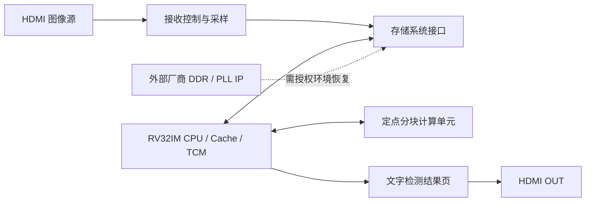
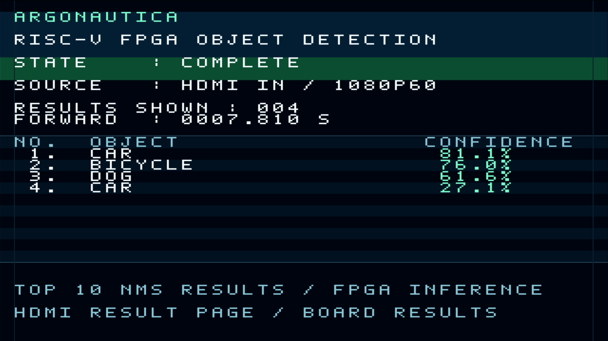

# ARGONAUTICA

基于 RV32IM 处理器与 FPGA 定点加速单元的目标检测系统。

ARGONAUTICA 面向盘古 50K FPGA 平台开发，包含五级流水 RISC-V CPU、Cache／TCM、裸机运行时、计算加速逻辑，以及 HDMI 图像采样与检测结果显示代码。完整系统曾实现从板载 Flash 启动，自动执行“采集输入 → YOLO 推理 → 显示结果 → 下一轮”。

本仓库展示项目源码与设计方法。厂商专有 IP、已配置位流、Flash 镜像和内部开发历史不随本仓库分发；它不是完整比赛交付包，也不是解压后即可直接下载上板的工程。

## 系统设计



- **CPU**：IF、ID、EX、MEM、WB 五级流水，提供乘除法、CSR、异常处理、前递、停顿及可配置分支预测。
- **存储**：指令／数据 Cache、片上 TCM 与外部 DDR3 接口。热点代码和栈使用 TCM，模型与工作区主要使用 DDR3。
- **计算**：INT8 权重与激活、定点重标定，CPU 通过 MMIO 调度分块计算路径，并完成后处理。
- **图像**：完整系统使用 1080p60 HDMI 输入，采样为 320×320 模型帧，输出独立文字结果页。
- **模型**：固定 YOLO-Fastest 1.1 COCO 模型及量化参数，保留上游来源与许可。

## 源码目录

| 路径 | 内容 |
|---|---|
| `rtl/`、`constr/` | CPU、Cache、SoC、外设与板级约束源码 |
| [demo/](demo/README.md) | 完整系统演示对应的软件快照及可公开的硬件部分 |
| `sw/` | 裸机启动、驱动、基准、自检和推理代码；可执行镜像不分发 |
| [models/](models/yolo_fastest_1_1/README.md) | 有明确来源的配置、模型与量化数据 |
| `sim/` | CPU、存储及计算模块的测试代码 |
| [pds/](pds/README.md) | 工程与构建脚本参考；完整实现前需恢复缺失 IP |
| [tools/](tools/README.md) | 模型转换、参考计算及开发辅助工具 |
| `third_party/` | 保留原许可的 CoreMark、riscv-tests 等依赖源码 |
| [docs/](docs/README.md) | 架构、源码使用、验证范围和分发说明 |

## 获取与软件检查

```bash
git clone https://github.com/BKMCICE/ARGONAUTICA.git
cd ARGONAUTICA
```

仓库中的第三方代码以实际文件保存，不需要通过内部工作目录补齐。使用 Python 3 核对分发文件字节，并检查演示应用的源文件与配方：

```bash
python tools/verify_source.py
python demo/software/build.py --check
```

若要编译该软件快照，准备支持 RV32IM／ILP32 的 xPack RISC-V GCC 15.2.0，并使用新的独立输出目录：

```text
python demo/software/build.py --toolchain <GCC-bin-directory> --output <new-output-directory>
```

该命令构建裸机软件，不会恢复缺失的 DDR3／PLL IP，也不会配置开发板。源码检查通过不等于完成物理实现。详细说明见[源码使用](docs/QUICKSTART.md)与[IP 恢复说明](IP_RESTORE.md)。

## 原系统实测摘要

完整系统在盘古 50K／PGL50H 平台上完成过 Flash 冷启动和三轮自动识别对照：狗图 → 纯白 → 狗图，检测数量为 4 → 0 → 4。狗图纯前向约 7.81 秒；相邻轮起点约 13 秒，包含 3 秒结果保持。

这些是原完整配置的有限实测结果。当前源码导出缺少厂商实现与原配置镜像，不能据此声称独立重现了同样的上板结果。输入 60 Hz 也不代表每秒完成 60 次识别。[验证范围](docs/VALIDATION.md)区分了源码检查、软件重建与物理测试。



## 分发与许可

项目原创部分尚未指定统一开源许可证；源码可见不等于已授予任意使用、修改或再分发许可。各第三方组件保留原版权及许可证，详见[第三方说明](docs/THIRD_PARTY_NOTICES.md)。

Pango 专有 IP、预编译硬件／固件、个人许可证、内部日志与原始 Git 历史均不属于本仓库的分发范围。本仓库不使用占位模块冒充已验证的厂商实现，恢复完整板级工程须另行具备相应环境与授权。
